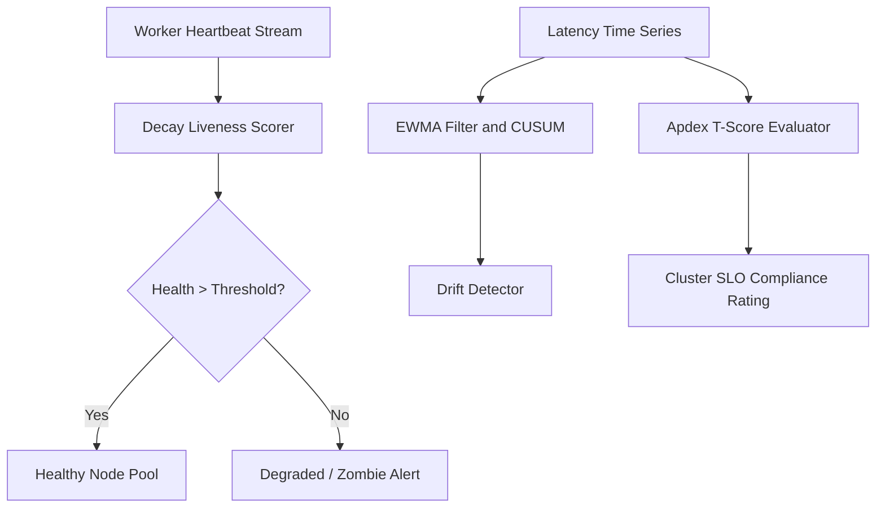

# openclaw-genpark-agent-monitor


OpenClaw GenPark Agent Monitor is an autonomous telemetry and SLO auditor implementing exponential decay liveness health checks, EWMA latency drift detection with CUSUM change-points, and Apdex (Application Performance Index) rating metrics.



## Features
- **Heartbeat Decay Liveness**: Exponential half-life decay formula H = exp(-lambda * delta_t) with configurable grace tolerance.
- **EWMA Drift and CUSUM**: Detects gradual and step-function latency drift away from baseline cluster SLOs.
- **Apdex Performance Index**: Measures user/agent satisfaction according to standard Apdex formulas (S + T/2) / N.

## MCP Runtime Requirements

Use Python 3.10+ for the MCP server. The core `client.py` has no external dependencies; MCP transport requires `mcp>=1.0.0,<2`. From this checkout, install it into the Python environment used by your MCP client:

```bash
python -m pip install -r requirements.txt
```

Use the same Python interpreter to launch `mcp_server.py`. In desktop client configuration, set `command` to that interpreter's absolute path.

## Quickstart

```python
from client import OpenClawGenParkAgentMonitor

mon = OpenClawGenParkAgentMonitor()
res = mon.evaluate_cluster_slos_and_apdex([45, 60, 110, 250, 600], target_t_ms=100.0)
print(res['apdex_rating'], res['apdex_score'])
```

## Local MCP Server

After installing the MCP requirements, launch the local STDIO server:

```bash
python mcp_server.py
```

Point your MCP client at the absolute path to `mcp_server.py` using the same Python interpreter. This repository does not provide a hosted MCP endpoint.

## License
MIT
