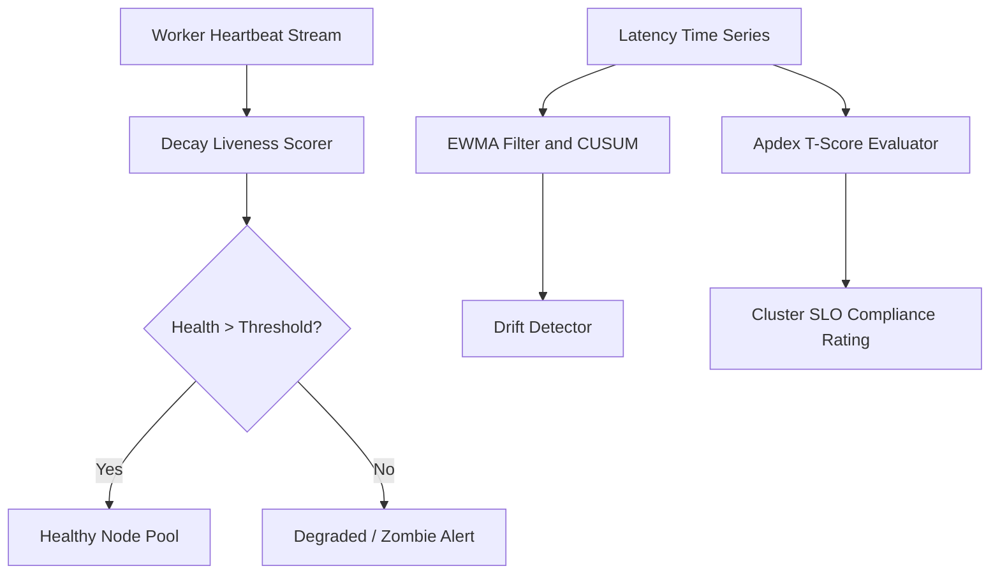

# openclaw-genpark-agent-monitor


OpenClaw GenPark Agent Monitor is a zero-dependency autonomous telemetry and SLO auditor implementing exponential decay liveness health checks, EWMA latency drift detection with CUSUM change-points, and Apdex (Application Performance Index) rating metrics.



## Features
- **Heartbeat Decay Liveness**: Exponential half-life decay formula H = exp(-lambda * delta_t) with configurable grace tolerance.
- **EWMA Drift and CUSUM**: Detects gradual and step-function latency drift away from baseline cluster SLOs.
- **Apdex Performance Index**: Measures user/agent satisfaction according to standard Apdex formulas (S + T/2) / N.

## Quickstart

```python
from client import OpenClawGenParkAgentMonitor

mon = OpenClawGenParkAgentMonitor()
res = mon.evaluate_cluster_slos_and_apdex([45, 60, 110, 250, 600], target_t_ms=100.0)
print(res['apdex_rating'], res['apdex_score'])
```

## License
MIT
